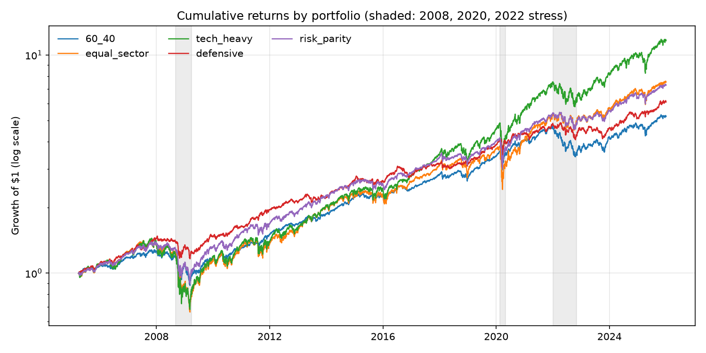
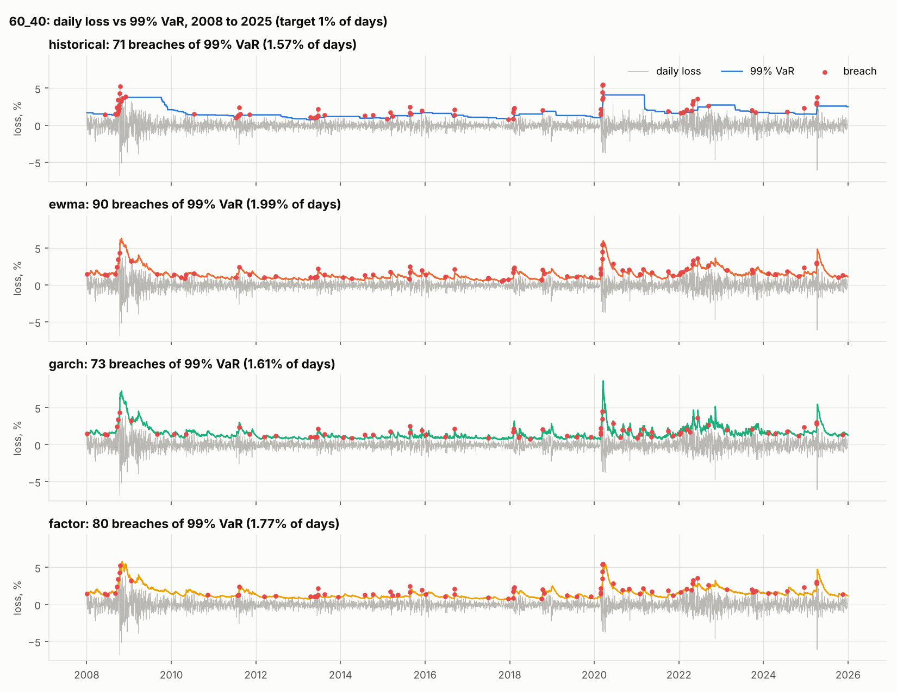
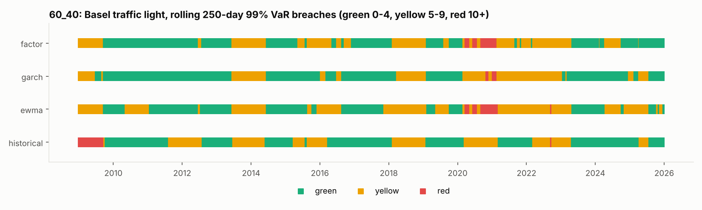
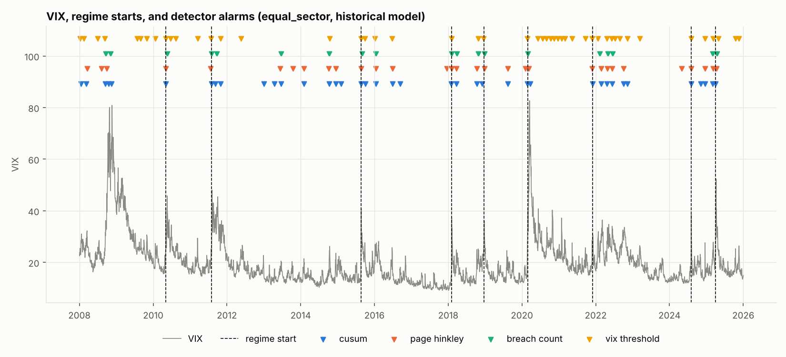

# RiskCheck results

Generated by `make report` on 2026-10-24. Every number below is read from files the pipeline writes; nothing is edited by hand.

## 1. Portfolios (2005 to 2025)

| Portfolio | Annual return | Annual volatility | Max drawdown | Worst day |
|---|---|---|---|---|
| 60_40 | 8.30% | 10.91% | -31.40% | -5.31% (2020-03-18) |
| equal_sector | 10.22% | 18.41% | -53.51% | -11.47% (2020-03-16) |
| tech_heavy | 12.57% | 19.43% | -52.90% | -12.53% (2020-03-16) |
| defensive | 9.11% | 9.65% | -21.31% | -6.01% (2020-03-12) |
| risk_parity | 10.04% | 12.85% | -35.95% | -7.79% (2020-03-12) |

## 2. VaR backtest, 4,529 trading days from 2008 to 2025

Averages over the 5 portfolios:

| Model | 95% breach rate (target 5%) | 99% breach rate (target 1%) | Kupiec rejects at 99% (of 5) | Basel red-zone days (avg) | ES ratio (target 1.00) |
|---|---|---|---|---|---|
| historical | 5.48% | 1.50% | 5 | 206 | 1.09 |
| ewma | 5.51% | 2.13% | 5 | 237 | 1.16 |
| garch | 6.47% | 1.57% | 5 | 27 | 1.02 |
| factor | 5.33% | 2.03% | 5 | 224 | 1.16 |

Every portfolio and model:

| Portfolio | Model | 99% breach rate | Kupiec p | Christoffersen p | Basel red days | ES ratio [95% CI] | ES Z2 |
|---|---|---|---|---|---|---|---|
| 60_40 | historical | 1.57% | <0.001 | <0.001 | 193 | 1.10 [1.03, 1.19] | -0.38 |
| 60_40 | ewma | 1.99% | <0.001 | 0.002 | 204 | 1.14 [1.09, 1.18] | -0.55 |
| 60_40 | garch | 1.61% | <0.001 | 0.037 | 54 | 1.02 [0.98, 1.06] | -0.45 |
| 60_40 | factor | 2.01% | <0.001 | <0.001 | 266 | 1.15 [1.10, 1.20] | -0.50 |
| equal_sector | historical | 1.59% | <0.001 | <0.001 | 452 | 1.10 [1.02, 1.20] | -0.39 |
| equal_sector | ewma | 2.38% | <0.001 | 0.019 | 362 | 1.16 [1.11, 1.21] | -0.84 |
| equal_sector | garch | 1.52% | 0.001 | 0.025 | 0 | 0.98 [0.94, 1.02] | -0.54 |
| equal_sector | factor | 2.25% | <0.001 | 0.036 | 369 | 1.16 [1.11, 1.21] | -0.74 |
| tech_heavy | historical | 1.68% | <0.001 | <0.001 | 236 | 1.09 [1.02, 1.17] | -0.48 |
| tech_heavy | ewma | 2.34% | <0.001 | 0.148 | 370 | 1.16 [1.12, 1.22] | -0.84 |
| tech_heavy | garch | 1.66% | <0.001 | 0.044 | 0 | 1.00 [0.96, 1.05] | -0.54 |
| tech_heavy | factor | 2.14% | <0.001 | 0.077 | 231 | 1.15 [1.10, 1.20] | -0.75 |
| defensive | historical | 1.35% | 0.026 | <0.001 | 0 | 1.08 [1.00, 1.17] | -0.31 |
| defensive | ewma | 1.85% | <0.001 | <0.001 | 0 | 1.16 [1.09, 1.22] | -0.49 |
| defensive | garch | 1.55% | <0.001 | <0.001 | 30 | 1.06 [1.01, 1.12] | -0.41 |
| defensive | factor | 1.83% | <0.001 | <0.001 | 16 | 1.17 [1.11, 1.23] | -0.54 |
| risk_parity | historical | 1.32% | 0.036 | <0.001 | 148 | 1.09 [1.01, 1.18] | -0.36 |
| risk_parity | ewma | 2.10% | <0.001 | 0.066 | 249 | 1.17 [1.12, 1.23] | -0.72 |
| risk_parity | garch | 1.52% | 0.001 | <0.001 | 49 | 1.02 [0.98, 1.07] | -0.46 |
| risk_parity | factor | 1.92% | <0.001 | 0.033 | 240 | 1.18 [1.12, 1.24] | -0.59 |

### Conformal VaR (from 2009-03-23, 4,222 days)

| Model | 99% coverage raw | 99% coverage conformal | 95% coverage raw | 95% coverage conformal |
|---|---|---|---|---|
| historical | 98.67% | 98.95% | 94.88% | 95.10% |
| ewma | 97.87% | 99.05% | 94.67% | 95.27% |
| garch | 98.43% | 99.09% | 93.78% | 95.27% |
| factor | 98.00% | 99.06% | 94.89% | 95.25% |

Kupiec rejections at 99%: 18 of 20 before, 0 of 20 after the correction.

### 99% breach rate by regime (average over portfolios)

| Regime | historical | ewma | garch | factor |
|---|---|---|---|---|
| 2022 rates shock | 3.35% | 2.31% | 1.99% | 2.31% |
| COVID Mar-Apr 2020 | 11.16% | 6.98% | 3.26% | 6.98% |
| Calm (all other days) | 1.15% | 2.13% | 1.57% | 1.99% |
| GFC 2008-2009 | 2.34% | 1.66% | 1.23% | 1.74% |

## 3. Regime drift detection (pre-registered; see prereg.md)

| Model | Detector | Detected | Median delay (days) | False alarms per calm year | Precision |
|---|---|---|---|---|---|
| historical | cusum | 82.22% | +0 | 1.01 | 0.48 |
| historical | page_hinkley | 82.22% | +0 | 1.10 | 0.41 |
| historical | breach_count | 71.11% | +1 | 0.35 | 0.68 |
| historical | vix_threshold | 100.00% | -1 | 0.00 | 1.00 |
| ewma | cusum | 80.00% | +0 | 1.77 | 0.28 |
| ewma | page_hinkley | 68.89% | -1 | 1.62 | 0.26 |
| ewma | breach_count | 46.67% | +0 | 0.31 | 0.55 |
| ewma | vix_threshold | 100.00% | -1 | 0.00 | 1.00 |
| garch | cusum | 68.89% | -1 | 0.83 | 0.43 |
| garch | page_hinkley | 66.67% | -1 | 0.52 | 0.52 |
| garch | breach_count | 53.33% | +0 | 0.50 | 0.49 |
| garch | vix_threshold | 100.00% | -1 | 0.00 | 1.00 |
| factor | cusum | 84.44% | +0 | 1.62 | 0.31 |
| factor | page_hinkley | 68.89% | -1 | 1.49 | 0.28 |
| factor | breach_count | 51.11% | +0 | 0.33 | 0.56 |
| factor | vix_threshold | 100.00% | -1 | 0.00 | 1.00 |

The VIX baseline cannot register a false alarm under this scoring (see the amendment in prereg.md), so its false-alarm and precision columns are not comparable.

Exploratory (added after seeing results): share of all alarms that fall near a regime start.

| Model | Detector | Alarms per year | Share near a regime start |
|---|---|---|---|
| historical | cusum | 2.03 | 27.47% |
| historical | page_hinkley | 1.76 | 25.95% |
| historical | breach_count | 1.10 | 40.40% |
| historical | vix_threshold | 2.67 | 25.00% |
| ewma | cusum | 2.46 | 16.74% |
| ewma | page_hinkley | 2.16 | 15.98% |
| ewma | breach_count | 0.82 | 28.38% |
| ewma | vix_threshold | 2.67 | 25.00% |
| garch | cusum | 1.69 | 22.37% |
| garch | page_hinkley | 1.21 | 27.52% |
| garch | breach_count | 1.17 | 24.76% |
| garch | vix_threshold | 2.67 | 25.00% |
| factor | cusum | 2.33 | 18.66% |
| factor | page_hinkley | 2.10 | 16.40% |
| factor | breach_count | 0.81 | 31.51% |
| factor | vix_threshold | 2.67 | 25.00% |

Simulation: volatility doubled at a random date, 1,000 runs.

| Model | Detector | Power | Median delay (days) | False alarms per year |
|---|---|---|---|---|
| ewma | breach_count | 23.30% | 14 | 0.38 |
| ewma | cusum | 90.50% | 5 | 2.78 |
| ewma | page_hinkley | 80.00% | 5 | 2.08 |
| historical | breach_count | 71.80% | 16 | 0.84 |
| historical | cusum | 99.20% | 6 | 2.43 |
| historical | page_hinkley | 95.90% | 6 | 1.91 |

## 4. AI risk copilot study

In progress. The design is pre-registered in prereg.md; results appear here after `make copilot-report`.
